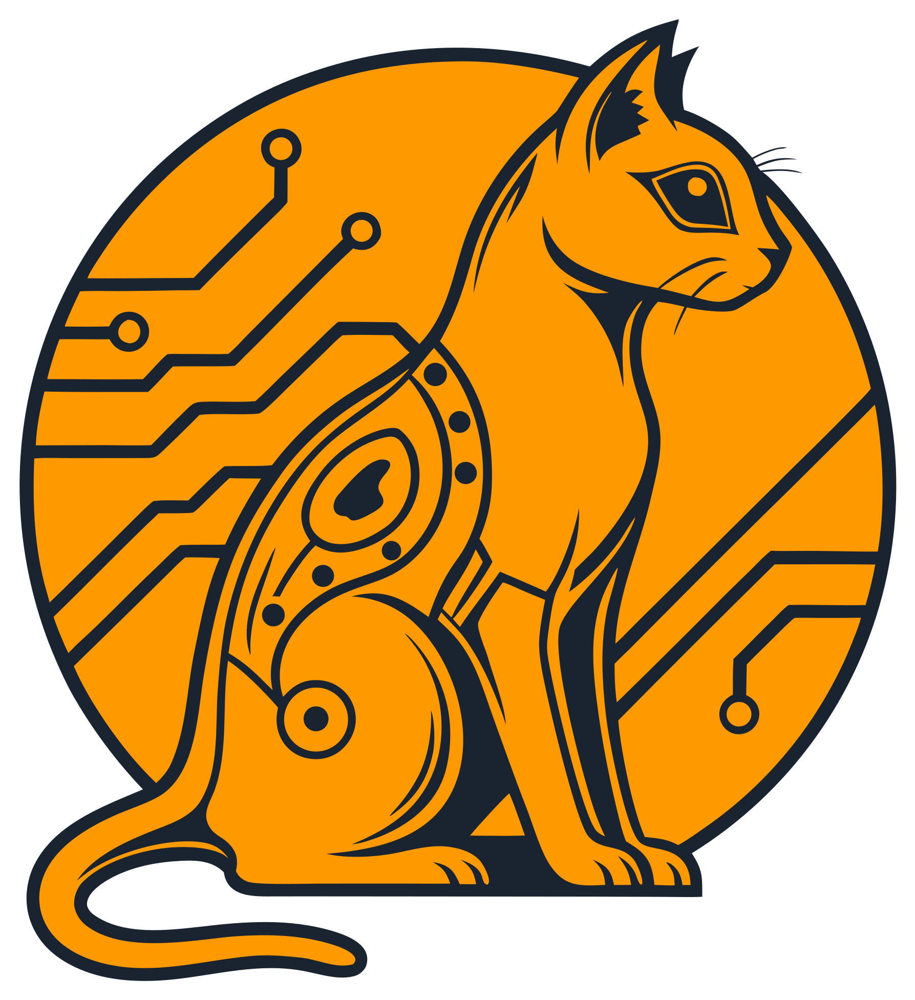

<div align="center">


# stdapi.ai

**OpenAI, Anthropic, Cohere & Ollama Compatible API Gateway for Amazon Bedrock and AWS AI Services**

Run your favorite OpenAI, Anthropic, Cohere and Ollama-compatible applications on Amazon Bedrock. Access [100+ models](https://stdapi.jgoutin.dev/models/?utm_source=github-readme&utm_medium=repo&utm_campaign=owned-surfaces) including Claude, OpenAI GPT, xAI Grok, Kimi, DeepSeek, Qwen with enterprise privacy, compliance controls, and pay-per-use AWS pricing.

---

[](https://registry.terraform.io/modules/stdapi-ai/stdapi-ai/aws/latest)
[](https://search.opentofu.org/module/stdapi-ai/stdapi-ai/aws/latest)
[](https://github.com/stdapi-ai/stdapi.ai/pkgs/container/stdapi.ai-community)
[](https://apps.truenas.com/catalog/stdapi-ai/)
[](LICENSE-AGPL)

[**Try it locally with Docker**](#-try-it-locally-with-docker)

[](https://stdapi.jgoutin.dev/?utm_source=github-readme&utm_medium=repo&utm_campaign=owned-surfaces)
[](https://github.com/stdapi-ai/samples)
[](https://github.com/stdapi-ai/stdapi.ai/actions/workflows/lint.yml)
[](https://app.codacy.com/gh/stdapi-ai/stdapi.ai/dashboard?utm_source=gh&utm_medium=referral&utm_content=&utm_campaign=Badge_grade)

</div>

> [!CAUTION]
> **stdapi.ai is discontinued.** v1.20.2 is its final release: no further development or support is planned. The source code stays available under the AGPL-3.0-or-later. See the [release notes](https://stdapi.jgoutin.dev/roadmap/?utm_source=github-readme&utm_medium=repo&utm_campaign=owned-surfaces).

---

## 🎯 Why stdapi.ai?

- **🔌 Same API, wider catalogue** — Adoption is quick: standard OpenAI, Anthropic, Cohere and Ollama SDKs connect on the base URL alone, and hundreds of applications and tools build on them; the model you then name is drawn from every provider in [the catalogue](https://stdapi.jgoutin.dev/models/?utm_source=github-readme&utm_medium=repo&utm_campaign=owned-surfaces), not one vendor's list. Twenty-two clients are driven end to end against a live gateway by the [automated test suite](https://github.com/stdapi-ai/stdapi.ai/tree/main/tests): **Claude Code**, **Codex**, **pi**, **OpenClaw**, **Hermes**, **Qwen Code**, **n8n**, **Haystack**, **Open WebUI**, **wyoming-openai**, **Home Assistant**, **LangChain**, **Pydantic AI**, **LiteLLM**, **Docling Serve**, **OpenAI Agents SDK**, **LiveKit Agents**, **Pipecat**, **inspect-ai**, **Agno**, **LlamaIndex**, the official **ollama** client.
- **🔒 Runs in your AWS account** — No third party sits between your users and your models. Amazon Bedrock does not share your prompts with model providers or use them for training — two models it serves today, Claude Fable 5 and Claude Fable 5.1, require your account to allow AWS's own human review of retained traffic; the compliance guide covers this in full. Configure region allow-lists to match your own requirements — AWS compliance certifications apply to the AWS services and regions you choose, and are not inherited by stdapi.ai or by your application. **[Compliance guide →](https://stdapi.jgoutin.dev/operations_compliance/?utm_source=github-readme&utm_medium=repo&utm_campaign=owned-surfaces)**
- **🌍 Add a region, add its quota** — Every AWS region has its own Bedrock quota, and every region you enable adds its own. Eligible throttling and availability failures retry in another enabled region, with no client changes. Streaming retries only before the stream opens, and asynchronous jobs stay in the region that accepted them. **[Resilience guide →](https://stdapi.jgoutin.dev/operations_resilience/?utm_source=github-readme&utm_medium=repo&utm_campaign=owned-surfaces)**
- **💰 Pay only what you use** — Amazon Bedrock rates with 0% markup: model usage is billed to you directly by AWS, with no minimum commitment. Each end user's model calls can run under their own short-lived role session, so AWS reports their spend separately in Cost Explorer and the CUR — from the invoice, not from an estimate.
- **⚡ Advanced Bedrock features** — Reasoning modes (Claude, Nova), prompt caching, guardrails, service tiers, inference profiles, prompt routers, batch inference at the discounted batch price, server-side conversations continued by id—all through standard OpenAI and Anthropic API parameters.
- **🧠 100+ models** — Claude, OpenAI GPT, xAI Grok, Kimi, DeepSeek, Qwen, GLM, Nova, Llama, Stability AI, and more. Switch model by name — no vendor lock-in. When AWS retires a model, requests are transparently redirected to its replacement, so applications survive deprecations without code changes.
- **🎨 Complete multi-modal API** — Chat, embeddings, image generation/editing/variations, video generation, audio speech/transcription/translation, live speech-to-speech over a WebSocket, content moderation. Amazon Bedrock, Bedrock Mantle, Polly, Transcribe and Comprehend are discovered automatically and surface as one catalog under OpenAI-compatible endpoints — and, for chat, generation and embeddings, under Ollama-compatible ones — no model list to maintain. Amazon Translate backs audio translation.
- **🔎 Retrieval without a second stack** — Attach a file and it is chunked, embedded and indexed in a vector bucket in your own account, then searched by meaning; an Amazon Bedrock knowledge base you already run answers through the same endpoints. Hand the stores to any chat model on the Responses API with `file_search` and it runs the searches itself and cites the files it drew on.
- **📊 Full observability** — OpenTelemetry integration, request/response logging, Swagger and ReDoc API documentation, and opt-in per-request cost tracking — off by default, and estimated from published AWS prices rather than read back from your invoice.
- **🤖 Integrated MCP server** — Every API endpoint an agent can use is exposed as a Model Context Protocol tool. AI agents connect directly—no HTTP client code required. Streamable HTTP and SSE transports with configurable tool selection.
- **🔑 Identity per caller** — Accept Amazon Cognito user pool tokens instead of, or alongside, the API key, and publish an OAuth 2.0 protected resource metadata document so an agent discovers how to authenticate on its own.
- **🏢 One gateway, many tenants** — Issue each customer or team its own API key, scoped to the models and endpoints it is entitled to, with per-minute request and token limits enforced across every instance and answered with a `429` carrying `retry-after`. Keys rotate on a schedule through AWS Secrets Manager, with an overlap window so nobody is locked out. **[Authentication & security guide →](https://stdapi.jgoutin.dev/operations_authentication_security/?utm_source=github-readme&utm_medium=repo&utm_campaign=owned-surfaces)**

**Measured, not asserted:** `<1 ms` gateway overhead (0.8 ms of gateway CPU on a 2.5 KB chat request) · **8,000+ automated test cases** run against real AWS services, at **95%+ branch coverage** · **22 third-party clients** driven end to end against a live gateway · **100+ API operations**, published as **90+ MCP tools**.

**[See all features →](https://stdapi.jgoutin.dev/features/?utm_source=github-readme&utm_medium=repo&utm_campaign=owned-surfaces)** · **[Browse every model →](https://stdapi.jgoutin.dev/models/?utm_source=github-readme&utm_medium=repo&utm_campaign=owned-surfaces)** · **[Browse the test suite →](https://github.com/stdapi-ai/stdapi.ai/tree/main/tests)**

---

## ⚡ Try It Locally with Docker

Run stdapi.ai locally with the container image. Requires [AWS credentials](https://docs.aws.amazon.com/cli/latest/userguide/cli-configure-files.html) configured (e.g. via `aws sso login` or access keys).

```bash
docker run --rm -p 8000:8000 \
  --user "$(id -u):$(id -g)" -e HOME=/home/nonroot \
  -v ~/.aws:/home/nonroot/.aws:ro \
  -e AWS_BEDROCK_REGIONS=us-east-1,us-west-2 \
  -e ENABLE_DOCS=true \
  ghcr.io/stdapi-ai/stdapi.ai-community:latest
```

<details>
<summary>Running as your own user — and why not to use <code>sudo</code></summary>

The image runs as the unprivileged user `nonroot` (uid/gid 65532); `--user` lets it read your own `~/.aws` files. Drop both flags when you pass credentials as environment variables instead.

**Never run this with `sudo`:** under `sudo`, `$(id -u):$(id -g)` resolves to `0:0`, and the container silently runs as root instead of `nonroot`. If your host has no `docker` group, add credentials as environment variables (below) instead of using `sudo` with `--user`.

**Podman on Fedora/RHEL (SELinux):** use `--userns=keep-id:uid=65532,gid=65532` in place of `--user`/`HOME`, and `:ro,z` instead of `:ro`
</details>

Open **[http://localhost:8000/docs](http://localhost:8000/docs)** in your browser — Swagger UI lets you explore all endpoints and send live requests without writing any code.

Or test from the terminal with `curl`:

**List available models:**

```bash
# All discovered models with capabilities, modalities, and supported routes
curl http://localhost:8000/search_models

# Filter — e.g. vision-capable chat models only
curl "http://localhost:8000/search_models?route=/v1/chat/completions&input_modalities=IMAGE"

# OpenAI-compatible model list
curl http://localhost:8000/v1/models
```

**OpenAI-compatible chat:**

```bash
curl http://localhost:8000/v1/chat/completions \
  -H "Content-Type: application/json" \
  -d '{
    "model": "amazon.nova-micro-v1:0",
    "messages": [{"role": "user", "content": "Hello from Amazon Bedrock!"}]
  }'
```

**Anthropic-compatible chat:**

```bash
curl http://localhost:8000/anthropic/v1/messages \
  -H "anthropic-version: 2023-06-01" \
  -H "Content-Type: application/json" \
  -d '{
    "model": "amazon.nova-micro-v1:0",
    "max_tokens": 1000,
    "messages": [{"role": "user", "content": "Hello from Amazon Bedrock!"}]
  }'
```

**Using the official SDKs?** Point `base_url` at `http://localhost:8000/v1` (OpenAI SDK), `http://localhost:8000/anthropic` (Anthropic SDK), or `http://localhost:8000/cohere` (Cohere SDK) — and the Ollama client's `host` at `http://localhost:8000/ollama` — no other code changes.

**[Local development guide →](https://stdapi.jgoutin.dev/operations_getting_started_local/?utm_source=github-readme&utm_medium=repo&utm_campaign=owned-surfaces)**

---

## 🚀 Production Deployment

Deploy to AWS with Terraform — two commands. The module deploys the hardened image `ghcr.io/stdapi-ai/stdapi.ai-community` and needs no subscription.

```hcl
module "stdapi_ai" {
  source  = "stdapi-ai/stdapi-ai/aws"
  version = "~> 1.20"
}
```

That deploys an auto-scaling ECS Fargate service in private subnets, with KMS-encrypted S3 storage and least-privilege IAM — reachable from inside the VPC only. A public HTTPS endpoint, WAF and API key authentication are opt-in:

```hcl
module "stdapi_ai" {
  source  = "stdapi-ai/stdapi-ai/aws"
  version = "~> 1.20"

  # Public HTTPS endpoint on a custom domain (ACM cert auto-issued via Route 53)
  alb_enabled           = true
  alb_public            = true
  alb_domain_name       = "api.example.com"
  alb_route53_zone_name = "example.com"

  # Optional protection and authentication
  alb_waf_enabled = true
  api_key_create  = true
}
```

The default deploys one task per availability zone, so a 3-AZ region runs 3 containers before ALB, NAT, Fargate and KMS costs; autoscaling can add up to 5× that under load by default, so size the ceiling in the [cost management guide](https://stdapi.jgoutin.dev/operations_cost_management/?utm_source=github-readme&utm_medium=repo&utm_campaign=owned-surfaces).

**[Full deployment guide →](https://stdapi.jgoutin.dev/operations_getting_started/?utm_source=github-readme&utm_medium=repo&utm_campaign=owned-surfaces)** · **[Advanced deployment →](https://stdapi.jgoutin.dev/operations_deploy_advanced/?utm_source=github-readme&utm_medium=repo&utm_campaign=owned-surfaces)** · **[Cost management →](https://stdapi.jgoutin.dev/operations_cost_management/?utm_source=github-readme&utm_medium=repo&utm_campaign=owned-surfaces)**

---

## 💼 Use Cases

| Category | What You Can Build | Tools | Guide |
|---|---|---|---|
| **💬 Chat Interfaces** | Private ChatGPT alternative, team chat, knowledge base with RAG | **Open WebUI**, LobeHub, AnythingLLM, LibreChat | [Guide →](https://stdapi.jgoutin.dev/use_cases_openwebui/?utm_source=github-readme&utm_medium=repo&utm_campaign=owned-surfaces) |
| **💻 Coding Assistants** | AI pair programming, code completion, codebase chat | **Claude Code**, **Codex**, **Qwen Code**, **pi**, Cline, OpenCode, Zed | [Guide →](https://stdapi.jgoutin.dev/use_cases_coding_assistants/?utm_source=github-readme&utm_medium=repo&utm_campaign=owned-surfaces) |
| **🔄 Workflow Automation** | AI-powered ticket routing, content creation, data processing | **n8n**, Langflow, Dify, Flowise | [Guide →](https://stdapi.jgoutin.dev/use_cases_n8n/?utm_source=github-readme&utm_medium=repo&utm_campaign=owned-surfaces) |
| **🤖 Chatbots** | Slack/Discord/Teams bots, documentation assistants | Dify, Chatwoot, Typebot | |
| **🧠 Autonomous Agents** | Personal AI assistants, research agents, multi-agent systems, code agents, evaluation harnesses | **OpenClaw**, **Hermes**, **Pydantic AI**, **OpenAI Agents SDK**, **Agno**, **inspect-ai**, **LiteLLM**, LangGraph, CrewAI | [Guide →](https://stdapi.jgoutin.dev/use_cases_autonomous_agents/?utm_source=github-readme&utm_medium=repo&utm_campaign=owned-surfaces) |
| **🔍 RAG & Voice** | Vector stores, semantic search, document pipelines, speech-to-speech assistants | **LangChain**, **LlamaIndex**, **Haystack**, **wyoming-openai**, **Docling Serve**, **LiveKit Agents**, **Pipecat**, RAGFlow | [Guide →](https://stdapi.jgoutin.dev/use_cases_rag/?utm_source=github-readme&utm_medium=repo&utm_campaign=owned-surfaces) |

**Bold** = driven end to end against a live gateway by the [automated test suite](https://github.com/stdapi-ai/stdapi.ai/tree/main/tests). The others have a documented setup and use the same standard SDKs.

**[All use cases and integration guides →](https://stdapi.jgoutin.dev/use_cases/?utm_source=github-readme&utm_medium=repo&utm_campaign=owned-surfaces)**

---

## 🏅 AWS Qualified Software

<div align="center">


stdapi.ai was approved by AWS as **AWS Qualified Software**, after AWS verified it against its technical and security requirements.
</div>

---

## 🛠️ Development from Source

For contributors working on stdapi.ai itself:

### Prerequisites

- Python 3.15+
- [uv](https://github.com/astral-sh/uv) package manager
- AWS credentials configured

### Setup

```bash
git clone https://github.com/stdapi-ai/stdapi.ai.git
cd stdapi.ai
uv sync --frozen --extra uvicorn

aws sso login --profile your-profile-name

export AWS_BEDROCK_REGIONS=us-east-1
export ENABLE_DOCS=true

uv run uvicorn stdapi.main:app --host 0.0.0.0 --port 8000
```

### Development Guidelines

- Follow existing code style and conventions
- Add tests for new features
- Update documentation for user-facing changes
- Ensure all tests pass before submitting PR

---

## 📜 License

Licensed under **[AGPL-3.0-or-later](LICENSE-AGPL)**.

**[Learn more about licensing →](https://stdapi.jgoutin.dev/operations_licensing/?utm_source=github-readme&utm_medium=repo&utm_campaign=owned-surfaces)**

---

## 🤝 Contributing

The project is discontinued, so new features are not planned. Bug reports and pull requests are still accepted on GitHub, without a promise of an answer.

---

## 💬 Links

- **Issues:** [GitHub Issue Tracker](https://github.com/stdapi-ai/stdapi.ai/issues)
- **Documentation:** [stdapi.ai](https://stdapi.jgoutin.dev/?utm_source=github-readme&utm_medium=repo&utm_campaign=owned-surfaces)

---

<div align="center">

**Ready to run [100+ AI models](https://stdapi.jgoutin.dev/models/?utm_source=github-readme&utm_medium=repo&utm_campaign=owned-surfaces) securely on AWS?**

[Deployment guide](https://stdapi.jgoutin.dev/operations_getting_started/?utm_source=github-readme&utm_medium=repo&utm_campaign=owned-surfaces) · [Terraform examples](https://github.com/stdapi-ai/samples) · [Try Locally with Docker](#-try-it-locally-with-docker)

</div>
